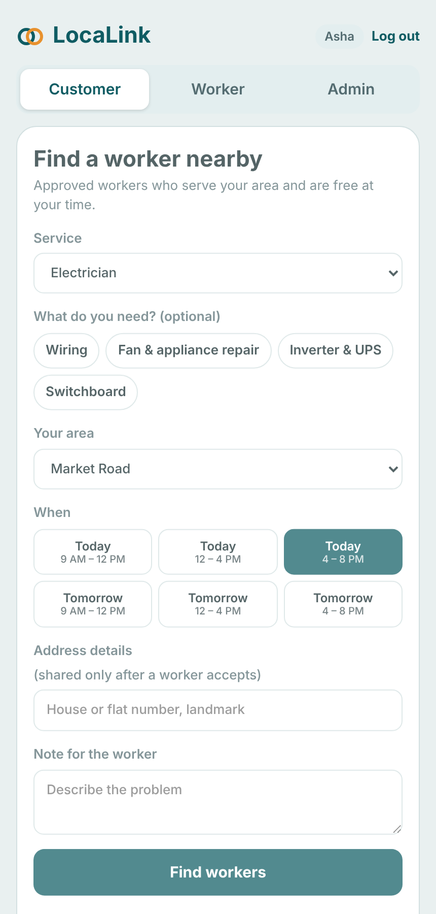
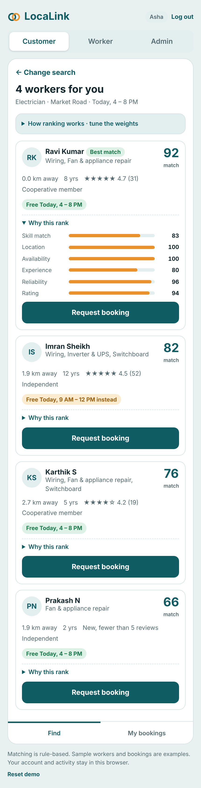
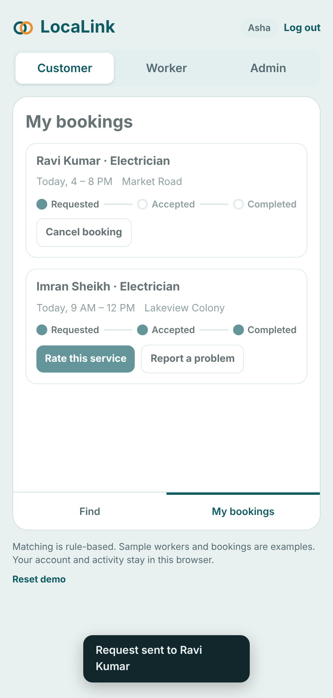
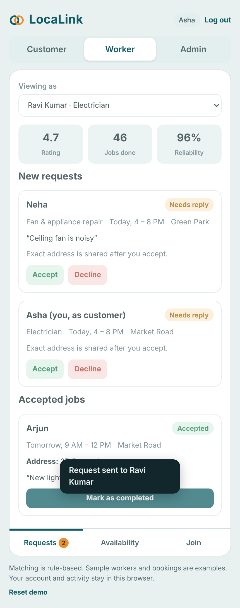
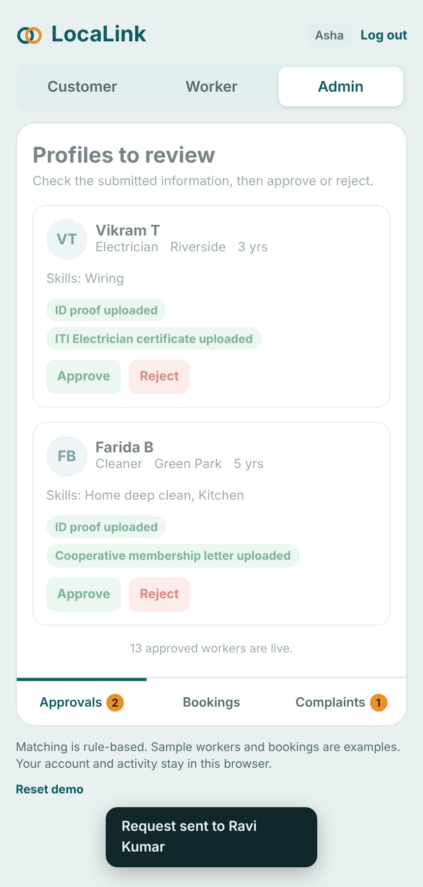

# LocaLink

**A digital platform connecting local skilled workers with nearby households.**

Electricians, plumbers, carpenters, cleaners, drivers, caregivers and other local workers mostly find
customers through word-of-mouth. Households struggle to find, compare and book nearby workers.
LocaLink gives workers an organized digital channel (skill profile, availability, booking requests,
ratings) and gives households ranked, available, verified workers near them.

Submitted to **Hack for Social Cause** (MY Bharat), theme: *Rural Development & Livelihoods*.
UN SDGs: SDG 8 (Decent Work), SDG 1 (No Poverty), SDG 10 (Reduced Inequalities).

## Project status (please read)

| Part | Status |
|---|---|
| Working prototype (this repo): customer, worker and admin flows, weighted matching, bookings, ratings, complaints, accounts | **Built, runs in the browser** |
| Automated tests for matching and accounts (`npm test`) | **15 tests, passing** |
| Production backend (FastAPI + PostgreSQL), mobile app (Flutter), maps and SMS | **Planned, not built** (see `docs/TECHNICAL_DESIGN.md`) |

The prototype is a front-end demo: all data is sample data and is stored only in the visitor's browser
(`localStorage`). There is no server. It demonstrates the product flow and the matching logic, not a
production deployment.

## Screenshots

| Search | Ranked results with score breakdown | Booking tracking |
|---|---|---|
|  |  |  |

| Worker requests | Admin approvals |
|---|---|
|  |  |

## Features

**Customer**: search by service, area and time slot; see workers ranked by a transparent match score
("Why this rank" breakdown); request a booking; track status (requested, accepted, completed); rate the
worker; report a problem.

**Worker**: create a skill profile and join (pending admin review); set availability; accept or decline
requests; the customer's exact address is shared only after accepting; mark jobs completed; build a
rating and reliability record.

**Admin**: review pending worker profiles and verification documents, approve or reject; monitor all
bookings; resolve complaints.

**Accounts**: sign up with a name and password, log in again later. Passwords are salted and hashed
with PBKDF2-SHA256 (150,000 iterations) via the Web Crypto API and are never stored in plain text.
Each user's bookings are saved separately in their browser.

## How the matching works

1. **Filter**: approved workers of the requested service, whose service radius covers the customer's
   area, and who are free at the chosen slot (or free at another slot the same day, flagged as such).
2. **Score** each remaining worker from six components, each scaled 0 to 1:

```
Match Score = ( w1*Skill + w2*Location + w3*Availability + w4*Experience + w5*Reliability + w6*Rating )
              / (sum of the weights that apply) * 100
```

| Component | How it is computed |
|---|---|
| Skill | share of the requested skill tags the worker has (a base score applies inside the right service) |
| Location | 1 - distance / the worker's service radius |
| Availability | 1 if free at the chosen slot, 0.5 if free at another slot that day |
| Experience | years of experience, capped at 10 years |
| Reliability | completed jobs / accepted jobs |
| Rating | average rating / 5, **only if the worker has 5 or more reviews** (otherwise left out) |

Default weights: skill 25, location 20, availability 15, experience 10, reliability 15, rating 15.
They can be changed with sliders in the app; they are starting values to be tuned on pilot data.
No machine-learning model is used or claimed.

## Run it locally

Requirements: any modern browser. Node.js 18+ is needed only for the tests.

```bash
git clone <this-repository-url>
cd localink

# Option 1: just open the file
open index.html            # macOS (or double-click index.html on any system)

# Option 2: serve it locally
npm start                  # runs: python3 -m http.server 8000
# then visit http://localhost:8000
```

Then: **Sign up** (any name and a password of 6+ characters), try **Customer**, **Worker** and **Admin**
from the role switch at the top. **Reset demo** at the bottom restores the sample data.

### Environment variables

The prototype needs **none**. The planned backend would use:

| Variable | Purpose | Status |
|---|---|---|
| `DATABASE_URL` | PostgreSQL connection string | planned |
| `SECRET_KEY` | signing key for login tokens | planned |
| `MAPS_API_KEY` | geocoding and distance | planned |
| `SMS_API_KEY` | booking notifications | planned |

### Optional main-password gate

Set `GATE_ENABLED = true` near the top of the script in `index.html`, open the app, tap *Create the
access code*, and paste the generated code into the `MASTER` constant. This is a light visitor gate that
runs in the browser, not server-side security.

## Tests

```bash
npm test
```

Covers: ranking order, radius filter, availability filter, "free another slot" flag, rating threshold,
pending workers hidden until approved, skill-tag scoring, reliability formula, sign-up validation,
duplicate names, no plain-text passwords, login, and per-user data separation. The tests load the real
script from `index.html`, so they exercise the shipped code.

## Sample data

`data/sample_data.json` holds the 15 sample workers (13 approved, 2 pending), the services and skills,
six fictional neighbourhoods with coordinates, time slots and example bookings. All names and places are
fictional.

## Repository layout

```
index.html                  the prototype (HTML, CSS, JavaScript; no build step)
data/sample_data.json       sample data
docs/TECHNICAL_DESIGN.md    architecture diagrams, data model, matching, security, roadmap
docs/screenshots/           screenshots of the running prototype
tests/                      automated tests (node:test)
LICENSE                     MIT
```

## Limitations

- Data is local to each browser. Nothing is shared between users and there is no real backend.
- No real identity verification, maps, payments or notifications yet; the admin approval step simulates
  the review process.
- Accounts are saved per browser; there is no password reset.
- Sample workers are fictional. Impact claims (more jobs, better access) are expected outcomes that need
  a real pilot to confirm.

## Roadmap

1. Pilot in one town with 3 to 5 service categories, via local cooperatives and self-help groups.
2. Build the FastAPI and PostgreSQL backend and a Flutter app; add maps and notifications.
3. Tune matching weights on real bookings; add multilingual and low-literacy-friendly screens.
4. Expand area by area; consider demand forecasting once there is enough data.

## License

MIT. See `LICENSE`.
