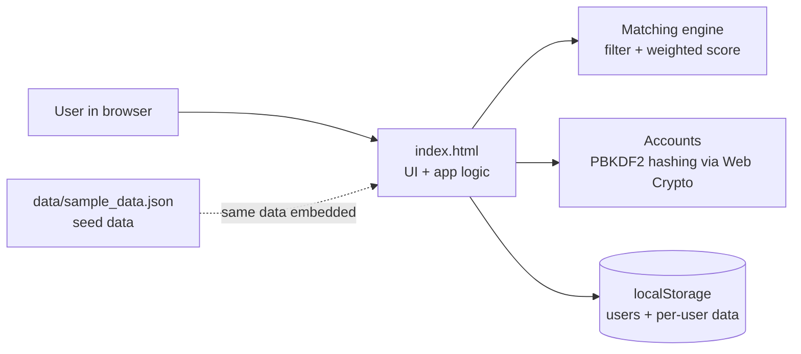
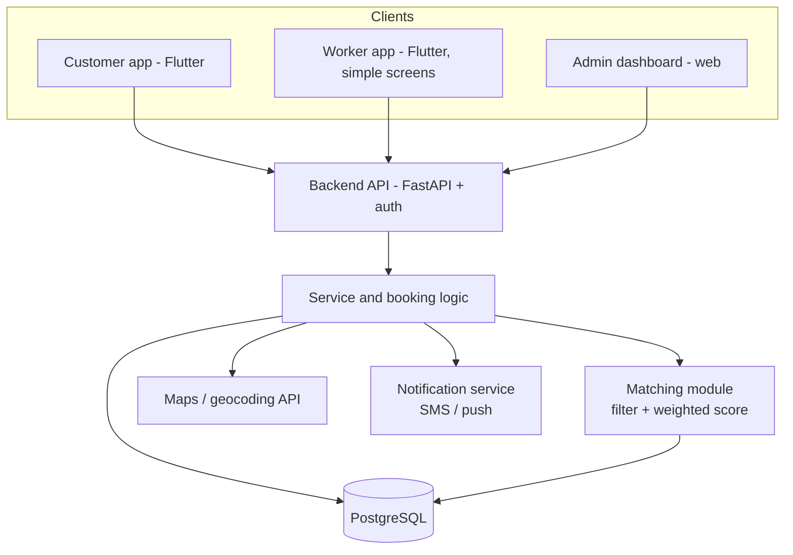
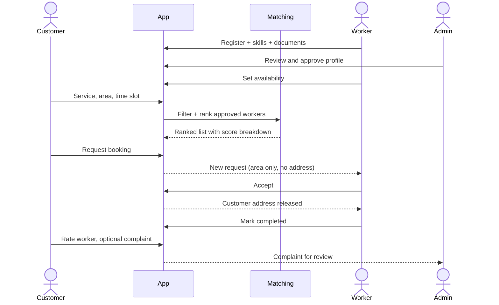
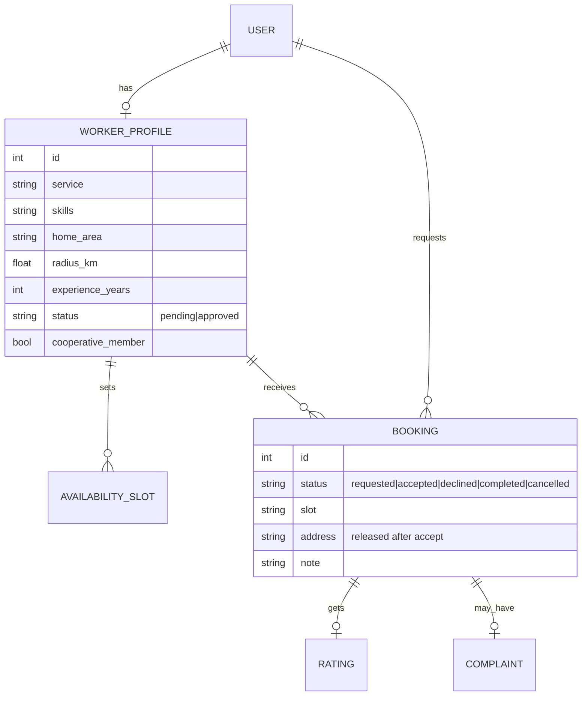

# LocaLink Technical Design

Status key: **[built]** exists in this repository's prototype, **[planned]** is the intended production design.

## 1. Goals

- Give local skilled workers a simple digital channel to be discovered and booked.
- Help households find nearby, available, verified workers and book them.
- Keep trust and privacy: verified profiles, ratings, complaints, address shared only after acceptance.
- Be cheap to run and easy to extend one area and service at a time.

## 2. System architecture

### 2.1 Prototype **[built]**



### 2.2 Production design **[planned]**



## 3. Booking flow



## 4. Data model



In the prototype the same shapes live in `data/sample_data.json` (workers, bookings, areas, slots, services).

## 5. Matching algorithm **[built]**

Two stages, rule-based and explainable.

**Stage 1, filter.** Keep a worker only if: status is approved; service equals the request; distance
(area to area) is within the worker's radius; and the worker is free at the requested slot or at another
slot on the same day.

**Stage 2, score** (each component 0 to 1):

```
Score = sum(w_i * c_i) / sum(w_i for the components that apply) * 100
c = Skill, Location, Availability, Experience, Reliability, Rating
```

- Rating applies only when the worker has at least 5 reviews, so new workers are not penalized.
- The score breakdown is shown to the customer ("Why this rank"), so ranking is transparent.
- Weights are adjustable and are meant to be tuned on pilot data.

Distance is a Euclidean distance on a coordinate grid (scaled to km) in the prototype; production would
use geocoded addresses and road or straight-line distance from a maps API.

**Why not machine learning yet:** there is no booking data to train on. A rule-based score can be built,
tested and explained now. Demand forecasting and learned ranking are future work once enough reliable
data exists.

## 6. Security and privacy

| Concern | Prototype **[built]** | Production **[planned]** |
|---|---|---|
| Passwords | PBKDF2-SHA256, random salt, 150,000 iterations, never stored in plain text | Server-side hashing (argon2 or bcrypt), rate limiting, password reset |
| Fake profiles | Admin approval step | Document verification, cooperative attestation |
| Address privacy | Worker sees area only until they accept | Same, plus masked phone calls |
| Data minimization | Name, password hash, bookings only | Collect only what is needed; delete on request |
| Access control | Role switch for demo purposes | Server-enforced roles (customer, worker, admin) |
| Complaints | Customer to admin queue | Audit log, action on verified misconduct |

The prototype's checks run in the browser, so they are a demo of the flow, not production security.

## 7. Planned API sketch **[planned]**

| Method and path | Purpose |
|---|---|
| `POST /auth/signup`, `POST /auth/login` | accounts |
| `POST /workers`, `PATCH /workers/{id}/availability` | worker profile and slots |
| `PATCH /admin/workers/{id}` | approve or reject |
| `GET /search?service&area&slot&skills` | ranked workers with score breakdown |
| `POST /bookings`, `PATCH /bookings/{id}` | request, accept, decline, complete, cancel |
| `POST /bookings/{id}/rating`, `POST /bookings/{id}/complaint` | feedback |

## 8. Testing

`npm test` runs 15 automated tests against the real prototype script: matching order, filters, rating
threshold, reliability formula, account validation, password storage and per-user data separation.

## 9. Scalability and cost

- Start with one town and 3 to 5 services; add areas and services gradually after pilot metrics.
- Software only, no special hardware. Estimated year-1 cash cost is roughly Rs 1 lakh (planning
  estimate): developer account, domain, cloud hosting, managed database, maps and SMS.
- Each new area mainly needs worker onboarding and local verification, not new infrastructure.

## 10. Roadmap

1. Pilot with cooperatives and self-help groups in one area; collect feedback.
2. Build the production backend and mobile apps; add maps and notifications.
3. Tune the weights on real bookings; multilingual and simple-screen modes.
4. Expand area by area; cooperative dashboards; optional digital payments with safeguards.
